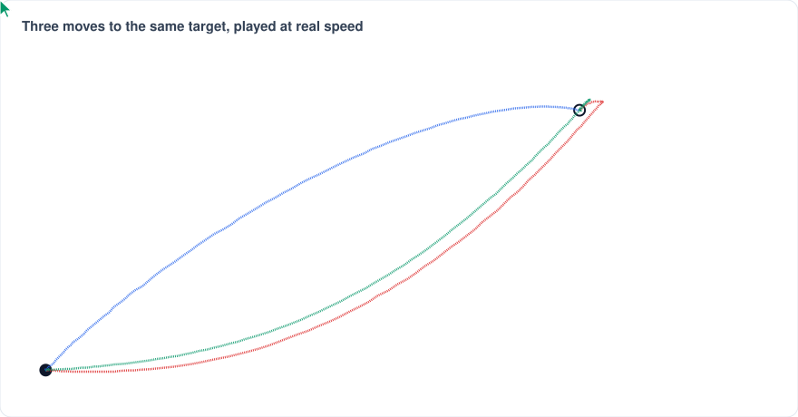
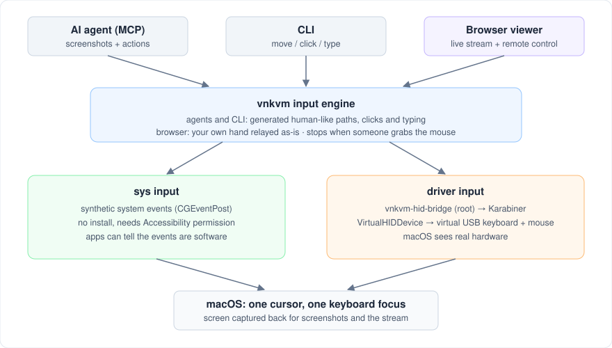
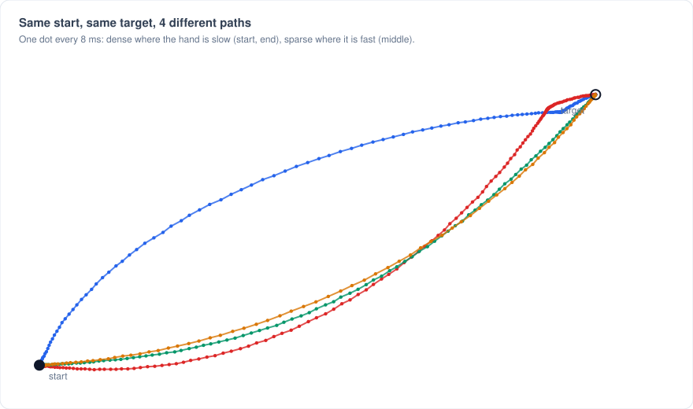
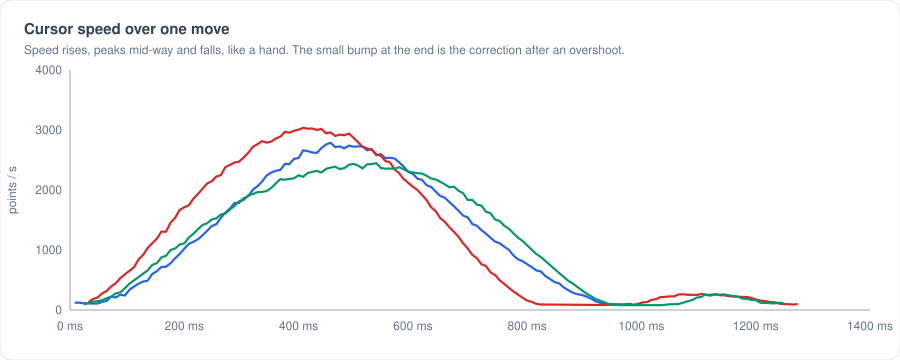

# virtual-nanokvm

A software KVM for macOS. It lets an AI agent, or a script, use your Mac's mouse and keyboard the way a person does, and lets you watch and control the Mac from a browser.

Inspired by the [Sipeed NanoKVM](https://sipeed.com/nanokvm-go), but with no extra hardware: it runs locally on the Mac it controls.



## How it works



One human-like input engine, two input paths:

| Input | How it reaches macOS | Setup |
|---|---|---|
| `sys` | Synthetic system events (`CGEventPost`) | Accessibility permission only |
| `driver` | Virtual USB keyboard and mouse ([Karabiner-DriverKit-VirtualHIDDevice](https://github.com/pqrs-org/Karabiner-DriverKit-VirtualHIDDevice)); macOS sees real hardware | Driver install plus a small root bridge |

## Human-like movement

A move never jumps, and no two moves are the same. Each one has:

- a curved path that bends to one side, like a wrist arc
- a natural speed: slow start, fast middle, slow finish
- Fitts's law timing: longer for far or small targets
- an overshoot and correction on some long moves
- a slight tremor that fades near the target

The pace is adjustable. `speed` on `act` and the mouse and key tools sets it for one call: 1 is a typical person (the default), 2 twice as fast, 0.5 half as fast, from 0.25 to 5. `VNKVM_MOUSE_SPEED` (or `--speed`) changes the default. Paths keep their shape, and grabbing the mouse still stops vnkvm. Typing keeps its own words-per-minute pace.





Around the target, behavior varies too. Some moves overshoot and come back, some fall short and finish with a second stroke, and long ones sometimes detour. Before a click the hand dwells, sometimes longer, sometimes with a tiny wobble. After a click it often drifts a few points away. Clicks, scrolling and typing get human timing too. If you grab the mouse mid-action, vnkvm stops, releases every key and button, and reports `user took control`.

## Install

One line (macOS 14+). It installs Go if needed (with Homebrew), builds vnkvm, links it to `~/.local/bin`, and runs a setup check:

```sh
curl -fsSL https://raw.githubusercontent.com/Lucklyric/virtual-nanokvm/main/install.sh | bash
```

Add `-s -- --claude --codex` after `bash` to install the agent plugins in the same step. Run `vnkvm doctor` at any time to see what is missing; `vnkvm doctor --fix` raises the macOS permission dialogs.

### As an agent plugin

**Claude Code**

```
/plugin marketplace add Lucklyric/virtual-nanokvm
/plugin install vnkvm@virtual-nanokvm
```

**Codex**

```sh
codex plugin marketplace add https://github.com/Lucklyric/virtual-nanokvm.git
codex plugin add vnkvm@virtual-nanokvm
```

Both install the MCP server and a `vnkvm` skill that teaches the agent the screenshot → act → check loop. The server builds itself on first start (Go and the Xcode command line tools are needed; the one-line installer sets them up). Re-running the installer with `--claude` or `--codex` also updates the plugins. Then run `/vnkvm:setup` in Claude Code, or ask Codex to "run the vnkvm doctor": it checks and requests the Accessibility and Screen Recording permissions for the app running the agent. Set `VNKVM_INPUT=driver` to use the driver input instead of `sys`.

**Any other MCP client**

```sh
git clone https://github.com/Lucklyric/virtual-nanokvm.git
virtual-nanokvm/scripts/vnkvm-mcp   # MCP server on stdio
```

| Tool | Does |
|---|---|
| `screenshot` | A low-detail look at the screen or one app window (even when covered), or a sharp zoom of part of an earlier shot, optionally with a crosshair where a click would land |
| `act` | Up to 20 planned actions in one call (move, click, type, key, hold, menu, scroll, drag, wait, expect), or a saved recipe, then a new low-detail look once the screen settles |
| `list_windows` | App windows with ids and positions |
| `mouse_move`, `click`, `drag`, `scroll`, `type_text`, `key` | Single actions, with an optional look afterwards |
| `lessons` | Per-app rules on what made tasks slow and what worked, versioned and measured per task, kept on this Mac |
| `recipes` | Saved sequences that worked in an app, replayed with one `act` call, kept on this Mac |
| `cursor_position` | Where the cursor is |
| `doctor` | Checks permissions, display, driver input and Tailscale |

Every image has a shot id, and coordinates are pixels of a named shot. vnkvm maps them to the screen, follows a window that moved, and refuses a window that changed size or a point another window covers. So an agent can look at 1024 px, zoom where it needs detail, and click from either image without mixing them up.

### Background mode

Tell the agent to work "in the background" and it passes `"mode": "background"`. vnkvm then leaves your cursor and your front app alone: it presses the control under the chosen pixel through Accessibility (the way VoiceOver does) and sends keys to that app only. You keep working while it runs.

Tested on macOS with each app behind another window:

| App | Click a control | Type into a field | Notes |
|---|---|---|---|
| Calculator | yes | n/a | `7 + 2 =` gave 9 |
| TextEdit | yes (focuses the text) | yes | `cmd` shortcuts such as Select All do not arrive; app-wide menu commands (File > New) do, through a `menu` step |
| Chrome (web page) | yes | yes | web buttons and links are focused, then pressed with Space or Enter |
| VS Code (Electron) | yes (buttons, text fields) | yes, after the click focuses a field | the main code editor area exposes no field; VS Code may suggest its screen reader mode |

Background mode cannot right-click (macOS brings the app forward for a context menu), double-click, drag or hover, and it cannot act on canvases such as games or maps, which have no controls. Use the default foreground mode for those.

Screenshots cover one app's window, never the whole display, unless you allow it with `VNKVM_ALLOW_DISPLAY=1`. `list_windows` shows window titles only for the app the agent names.

The bundled skill teaches the agent to plan: look once, chain every step it can already see into one `act` call, prefer keyboard shortcuts, and stop the sequence where the next target only appears after the screen changes. One model turn then covers several actions. When the server sees a slow loop (looks without actions, single actions in a row, a repeated failure), it says so in the tool result, and the agent records a one-line lesson for that app in `~/.config/vnkvm/lessons/`. The next task in that app starts by reading it.

The agent gets faster with use in three ways:

- **Predictions.** An `expect` step lets the agent chain past a screen change it can predict (a menu opening, a dialog appearing). If the change does not come, the sequence stops before the next steps.
- **Recipes.** A sequence that worked can be saved and replayed in one call. Recipes store window-relative positions and never the typed text, which becomes a placeholder. Screenshots of an app list its recipes.
- **Measured lessons.** At the end of each task the agent reports it done, and the server records what it cost (tool calls, steps per call, misses) under the current lessons version. Every fifth task, or when a new version makes tasks slower, the server asks the agent to revise the lessons; `/vnkvm:review` in Claude Code runs a review on demand. Each lesson is tagged with the version that added it, so a bad change can be traced and dropped.

### Watch and control from a browser

```sh
vnkvm serve --input sys              # on your local network
vnkvm serve --input sys --tailscale  # on your tailnet, from anywhere
```

It prints two links: a control link (watch, plus mouse and keyboard) and a view link (watch only). Click **Take control** to drive the Mac; your own hand movement is relayed as-is. One person controls at a time, and every key and button is released when they leave.

Video works as on the NanoKVM: H.264 (hardware-encoded with VideoToolbox, decoded in the browser with WebCodecs) when the page is HTTPS or localhost, otherwise MJPEG. The viewer picks automatically.

**Tailscale:** `--tailscale` shares the viewer on your tailnet only. If your tailnet has HTTPS certificates (Tailscale admin console > DNS > enable HTTPS Certificates), vnkvm binds localhost and runs `tailscale serve` on port 8443, so viewers get an `https://<mac>.<tailnet>.ts.net:8443` link and H.264. Without certificates it serves plain HTTP on the tailnet address (still encrypted by WireGuard), and viewers get MJPEG.

Flags: `--listen` (default `:8090`), `--fps` (default 10), `--width` (default 1280), `--kbps` (H.264 bitrate, default 3000), `--token` and `--view-token` (random by default). Without `--tailscale`, links travel over plain HTTP, so use your LAN only if you trust it. Some shortcuts such as `cmd+w` stay with the browser. Unlike a hardware KVM, macOS hides the screen from capture while it is locked or asleep.

### Command line

```sh
make service
bin/vnkvm move  --input sys 800 450
bin/vnkvm click --input sys 800 450
bin/vnkvm type  --input sys "hello"
```

### Driver input (real USB HID)

1. Install `Karabiner-DriverKit-VirtualHIDDevice-8.6.0.pkg` and approve its system extension.
2. Start the Karabiner daemon and the bridge as root:
   ```sh
   make bridge
   sudo bin/vnkvm-hid-bridge --socket /var/run/vnkvm-hid.sock --owner $(id -u)
   ```
3. Use `--input driver` (the default).

See [docs/design.md](docs/design.md) for the full design.

## Tests

```sh
make test
```

The engine is tested against a simulated screen with pointer acceleration. The tests check that moves land within 1 point, follow a bell-shaped speed curve, curve rather than run straight, differ every time, and stop when a hand takes over. The figures above come from the same simulation:

```sh
go test ./internal/human -run TestWriteFigures -figures "$PWD/docs/img"
```

## License

MIT
